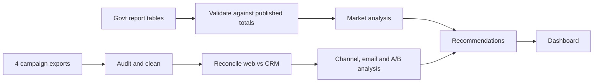

# University Student Recruitment Insights

A marketing analytics project in two parts:

1. **Market analysis on real data.** Where demand for undergraduate study is growing, using the Australian Government's *Undergraduate applications and offers 2025* report.
2. **Campaign analytics case study.** A 12-week student recruitment campaign for a fictional Perth university, covering a data integrity audit, channel ROI, marketing automation performance and an A/B test.

**Live dashboard:** https://arzookhokhar.github.io/campaign-insights

## Data

| Part | Source | Real? |
|---|---|---|
| National applicants and offers 2010–2025, offers by field, field growth, state growth, Year 12 propensity, applications vs unemployment, Nursing and Teaching by state | Department of Education, *Undergraduate applications and offers 2025* (CC BY 4.0) | **Real** |
| Web analytics, ad spend, CRM leads, email automation, A/B test | Generated by `src/generate_data.py` | Simulated |

Universities don't publish internal campaign data, so the campaign section uses simulated exports. They are built to include the problems real exports have: inconsistent channel names, duplicate CRM records, missing UTM tags and impossible email metrics.

## Key findings

**From real sector data**

- Applications rose **5.4%** nationally in 2025 but fell **0.2%** in WA. A WA university has to grow by winning share.
- Education was the fastest-growing field (**+12.0%**), and **76.5%** of its offers went to applicants without an ATAR or not in Year 12, so mature-age audiences matter.
- WA Nursing applications grew **5.5%** (national 2.3%), but only **66%** of WA applicants received an offer (76% nationally). Demand exceeds places.
- WA Teaching applications grew only **1.0%** against **12.3%** nationally.
- Since 1989, changes in applications have moved with the prior year's change in unemployment (**r = 0.6**).

**From the simulated campaign**

- Paid Search costs **$162** per application vs **$599** for Paid Social.
- Paid Social cost per lead rose **60%** over 12 weeks, a sign of ad fatigue.
- Course page variant B lifted conversion **24.5%** (p < 0.001).
- **5.8%** of CRM leads had no source tag.

## Approach



| File | What it does |
|---|---|
| `market.py` | Growth, offer rates, WA vs national indices, correlation, sector insights |
| `audit.py` | Standardises names, removes duplicates, flags bad rows, reconciles systems |
| `analyse.py` | CPL, CPA, funnel, email rates, two-proportion z-test, campaign recommendations |
| `generate_data.py` | Creates the simulated campaign exports |
| `run.py` | Runs everything and builds `index.html` |
| `template.html` | Dashboard design |
| `national_applicants_offers.csv`, `offers_by_field_2025.csv`, `field_growth_2025.csv`, `state_growth_2025.csv`, `nursing_teaching_by_state.csv`, `applications_vs_unemployment.csv`, `year12_propensity_to_apply.csv` | Real sector data transcribed from the report |
| `web_analytics.csv`, `ad_platform_spend.csv`, `crm_leads.csv`, `email_automation.csv`, `ab_test_course_page.csv` | Simulated campaign exports |

## Run it

```bash
pip install -r requirements.txt
python src/generate_data.py
python src/run.py
```

## Tech stack

Python, pandas, NumPy, Chart.js, GitHub Pages

## Attribution

Sector data © Commonwealth of Australia, Department of Education, *Undergraduate applications and offers 2025*, licensed under CC BY 4.0.

Built by [Arzoo](https://arzookhokhar.github.io).
